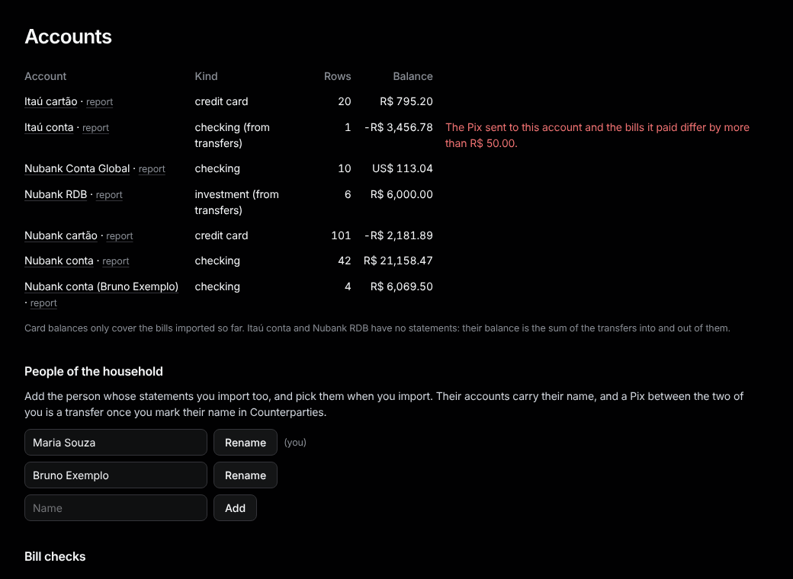
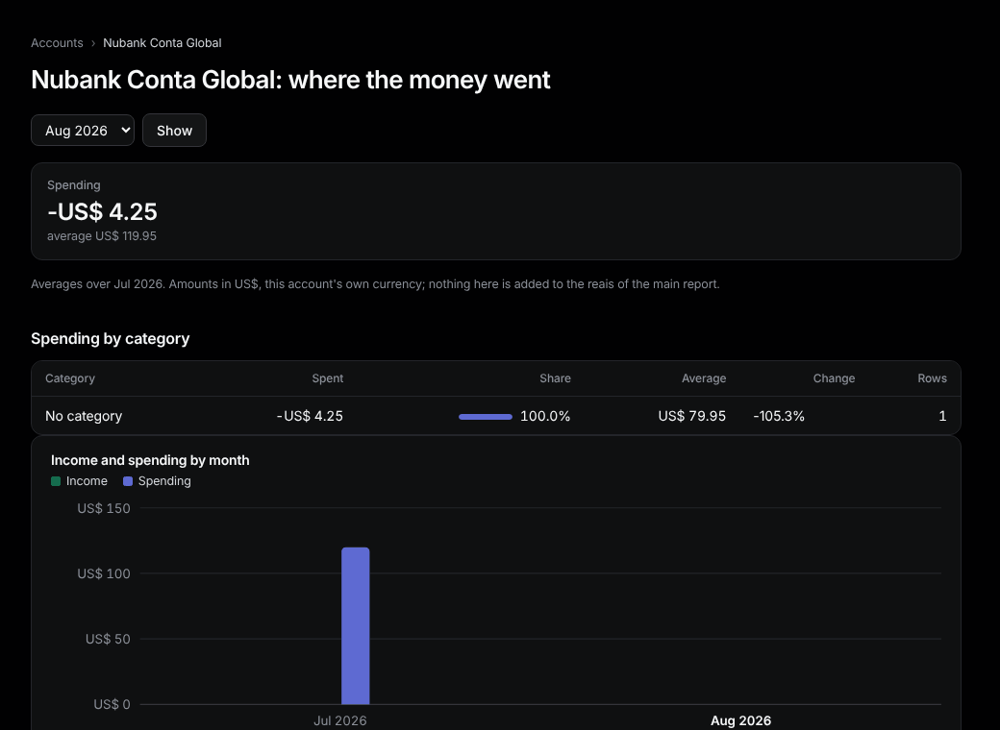

# Accounts

Sidebar: **Data › Accounts**.

Each account with its balance, owner and a **report** link. Card balances cover only the bills imported so far.

## People of the household

1. Type a name and press **Add**. Press **Rename** to fix one.
2. Import their files choosing their name under **Whose statements:**. Their accounts carry their name.
3. In [Counterparties](counterparties.md), mark their name as theirs, so a Pix between you is a transfer.

With two people, Home, Report and Budgets get a **Household / person** switch. Budgets stay household-wide.

## Bill checks

For each card bill: **paid in full**, **open** (part paid), **differs by** an amount, or **payment not imported yet**.

## Account report

The **report** link shows one account's spending by category and month. Conta Global stays in US$, never added to the reais of the main report, with what your top-ups cost per dollar.

