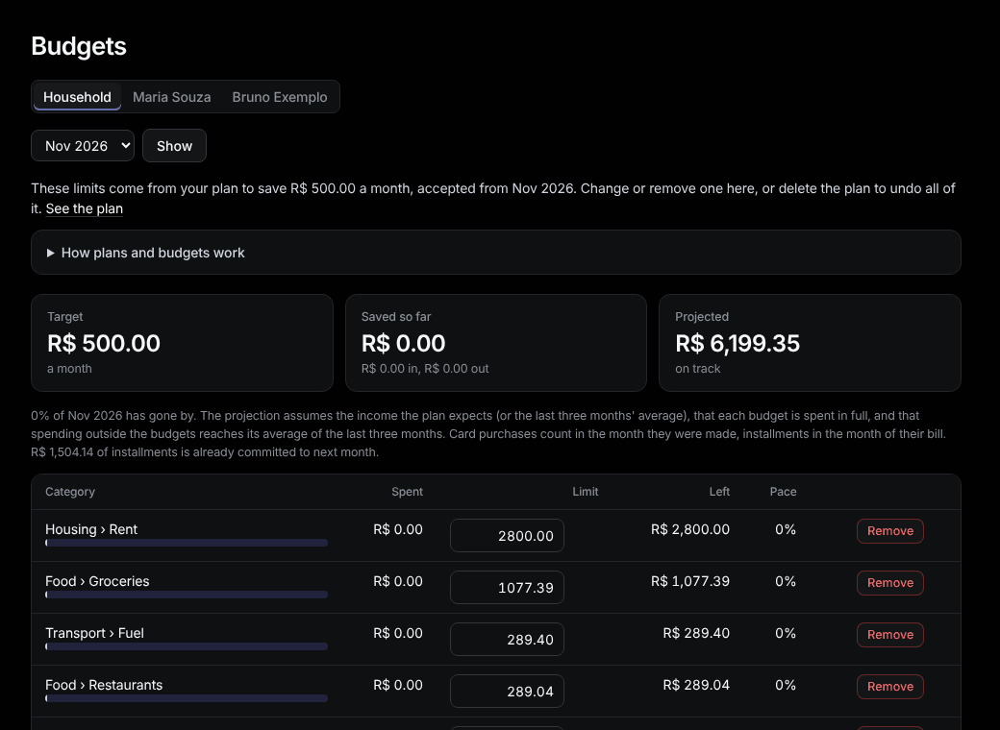

# Budgets

Sidebar: **Planning › Budgets**.

A budget is a monthly limit for one category. Accepting a [savings plan](plan.md) writes them, or set one by hand under **Add a budget** at the bottom (category, limit, **Save**).

**Read it.** Per category: **Spent**, **Limit**, **Left** and **Pace** (spent against what the limit allows by today; over 110% is flagged **over**). The cards on top show the target, what is saved so far and the projection for the month. After the month ends, **Month-end scores** say whether the target was reached.

**Change it.**
- Edit a limit and press Enter: it applies from that month on.
- **Remove** ends a budget from that month on; earlier months keep it.
- **Remove all budgets from …** clears them all from that month on.
