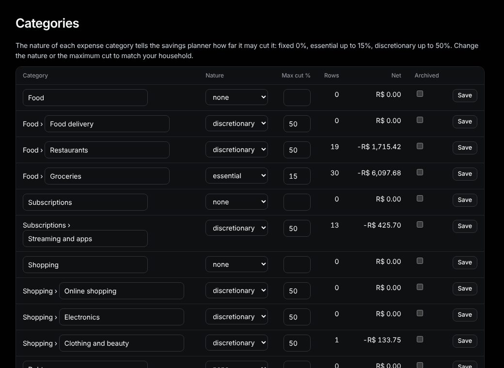
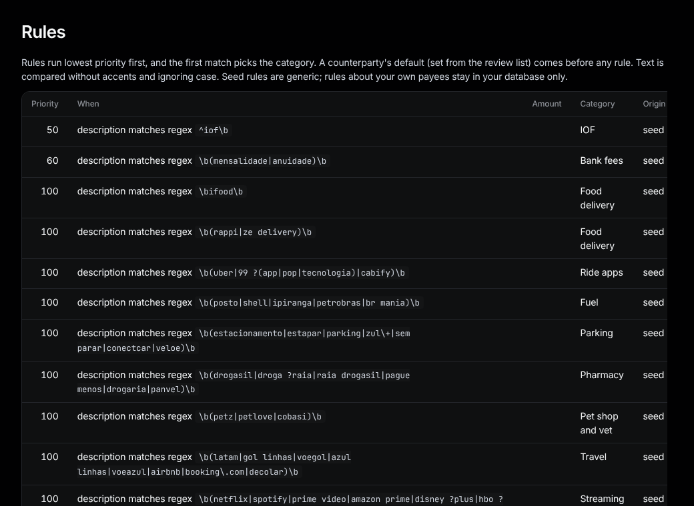

# Categories and rules

## Categories

Sidebar: **Organize › Categories**.

- **Add:** fill the form at the bottom (name, top level or under a parent, kind, nature) and press **Add**.
- **Rename / change nature or Max cut %:** edit the row and press **Save**.
- **Archive:** tick **Archived** and press **Save**. Untick to bring it back.

The nature tells the [savings plan](plan.md) how far it may cut: fixed 0%, essential up to 15%, discretionary up to 50%.

## Rules

Sidebar: **Organize › Rules**.

A rule picks a category when a row matches, for example *description contains "uber"* → Ride apps.

- **Add:** pick what to match, how (contains, is, starts with, matches regex), the text, optionally an amount range and whose statements, then the category, and press **Add**.
- **Switch one off:** press **Remove**. Seed rules (**Origin: seed**) come with Tally; removed ones don't come back.
- Lower **Priority** runs first; the first match wins. A payee's "always" from Review comes before any rule.
- Rows you categorized by hand are never touched; every other row is categorized again when rules change.
