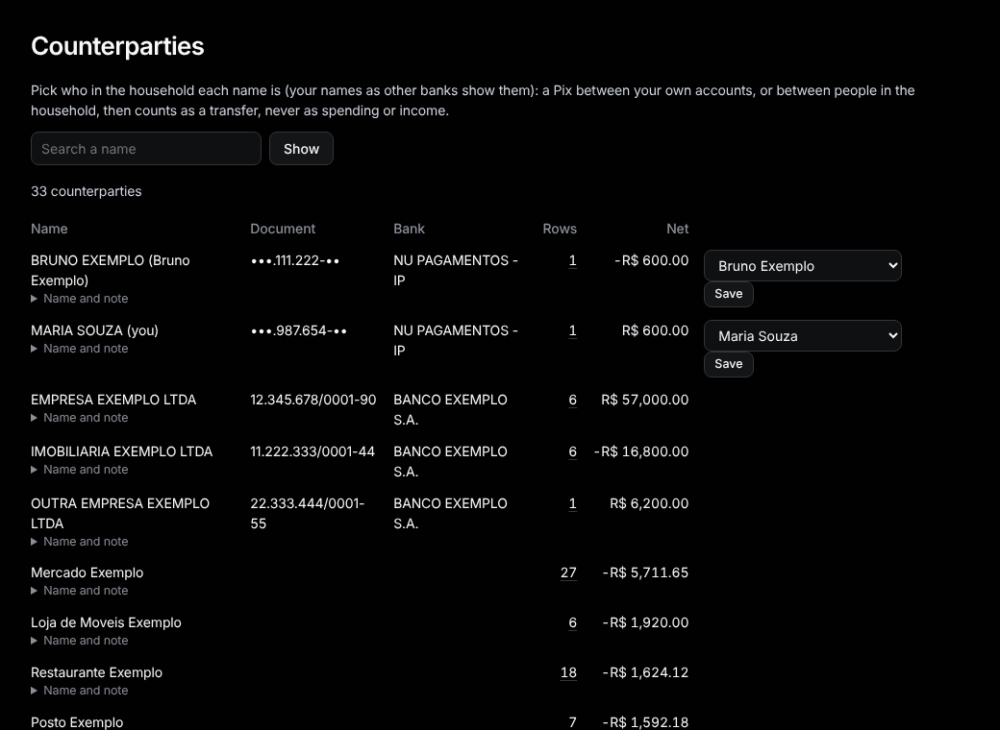

# Counterparties

Sidebar: **Organize › Counterparties**.

Everyone money went to or came from. Card merchants are grouped by their stable name, so "LATAM AIR*ABC" and "LATAM AIR*XYZ" are one.

**This is me.** Find your own name as other banks show it and press **This is me**. A Pix between your accounts then counts as a transfer, not spending or income. With two people in the household, pick who each name is and press **Save** instead. A Pix that shows only a name (no CPF or bank) gets the same choice, here and in [Review](review.md); it pairs with the other person's side once their statement has the same amount within a few days. A Pix to Nubank (NU PAGAMENTOS S/A) that paid the other person's Nubank card bill pairs with the payment on their card by itself, so it counts once.

**Name and note.** Click **Name and note** to give a payee your own name for it and a note. Imports and rules keep using the bank's name. On the counterparty's page, **It's a subscription** lists it on [Subscriptions](subscriptions.md) even when it isn't found there, and **See its transactions** opens its rows.

**Search a name** filters the list.
