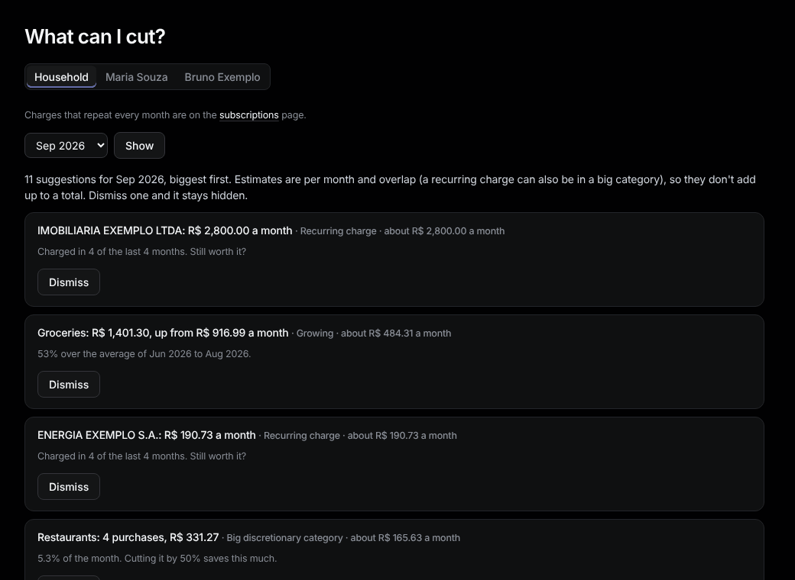

# Cuts

Sidebar: **Overview › Cuts** ("What can I cut?").

Suggestions for the latest month, biggest first, each with about how much it saves a month:

- **Big discretionary category**, **Growing** (over its average), **Many small purchases**
- **Recurring charge**, **New installments**, **Fees and interest**, **Possible duplicate charge**

Estimates overlap, so they don't add up to a total. Press **Dismiss** to hide one; it stays hidden. Find it under **Dismissed** and press **Show again** to bring it back.
