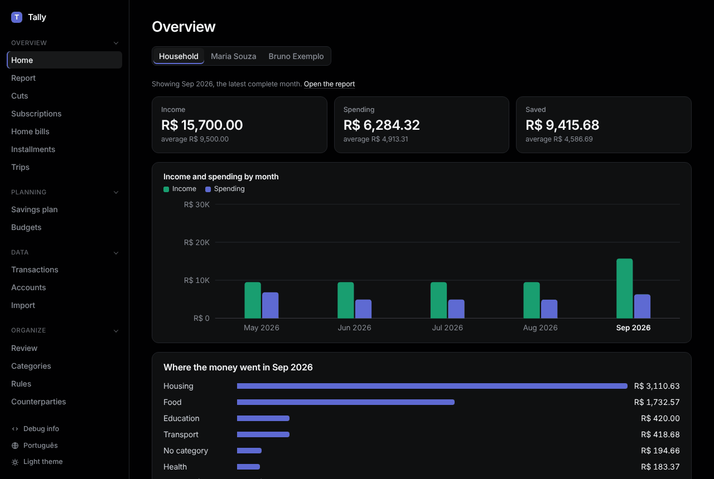

# First run

```sh
bin/setup   # gems, databases, privacy hook
bin/dev     # http://localhost:2300
```

Then [import your statements](import.md).



**Sidebar.** Four sections: Overview, Planning, Data, Organize. Click a section's title to fold it; Tally remembers which are folded.

**Language.** At the bottom of the sidebar, press **Português** or **English**. Category names Tally created follow the language; names you typed stay as typed.

**Theme.** Press **Light theme** or **Dark theme**. Once you picked one, **System theme** goes back to following your computer.

## Every month

1. **Import** last month's statements and card bills.
2. **Review**: give the new rows a category.
3. **Report**: see where the money went.
4. **Budgets**: check you are on track.
