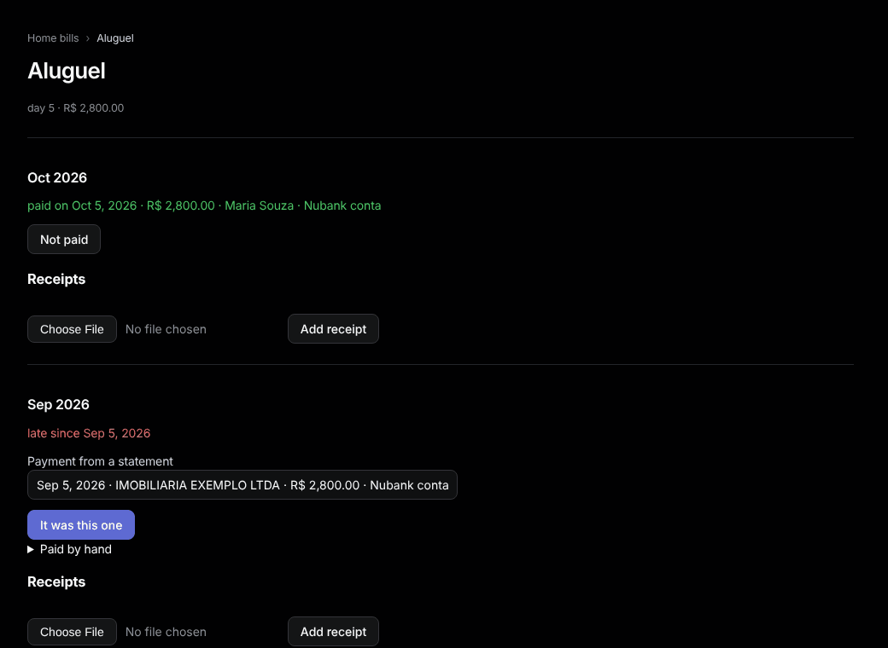

# Home bills

Sidebar: **Overview › Home bills**.

Rent, energy, water, internet: what is due each month and who paid it.

1. Under **New home bill**, type a name, the **Due day**, optionally the expected amount and category, and press **Add**. Or press **Track as home bill** on [Subscriptions](subscriptions.md).
2. Open the bill. For each month:
   - pick the statement row under **Payment from a statement** and press **It was this one**, or
   - open **Paid by hand**, fill the day, amount and **Who paid**, and press **Mark paid**.
3. Under **Receipts**, choose a JPEG, PNG or PDF (up to 10 MB) and press **Add receipt**.

A month shows **paid on**, **due on** or, in red, **late since**. **Not paid** undoes a payment. A linked payment's payer is the account's owner. Bills, payments and receipts survive `bin/reset-db`.
