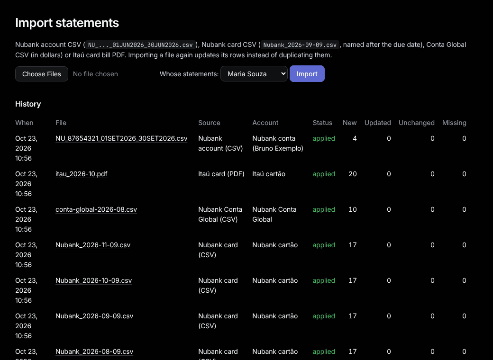

# Import

Sidebar: **Data › Import**.

1. Under **Whose statements:**, pick the person (only shows with more than one person).
2. Choose one or more files and press **Import**.
3. The result page shows how many rows are **New**, **Updated**, **Unchanged** and **Missing**, plus any warnings.

| File | Name it like |
|---|---|
| Nubank account CSV | as exported: `NU_..._01JUN2026_30JUN2026.csv` |
| Nubank card CSV | the bill's due date: `Nubank_2026-09-09.csv` |
| Itaú card bill PDF | anything |
| Conta Global CSV (US$) | anything |
| XP card CSV | the bill's due date: `Fatura2026-10-15.csv` (as exported) |

From the command line: `bundle exec rake "tally:import[data/statements/*]"`, or `"tally:import[files,Name]"` for someone else's files.

## Importing again

- A file with new rows **updates** the old ones, it never duplicates them. Your categories, notes and adjustments stay.
- The exact same file again changes nothing ("This exact file was already imported").
- Rows that vanished from a newer file are kept and listed under **No longer in the file**.
- **Missing statements** (on Import and Accounts) lists months between your files that were never imported.

## Starting over: `bin/reset-db`

Use it when an importer fix needs every file read again. Stop `bin/dev`, run it, type `yes`. It saves a backup copy first.

- **Kept:** home bills, their payments and receipts.
- **Redo after re-importing:** "This is me" and household names in [Counterparties](counterparties.md), "always" choices in [Review](review.md), your rules and category edits, adjustments, trips, the plan and budgets.
