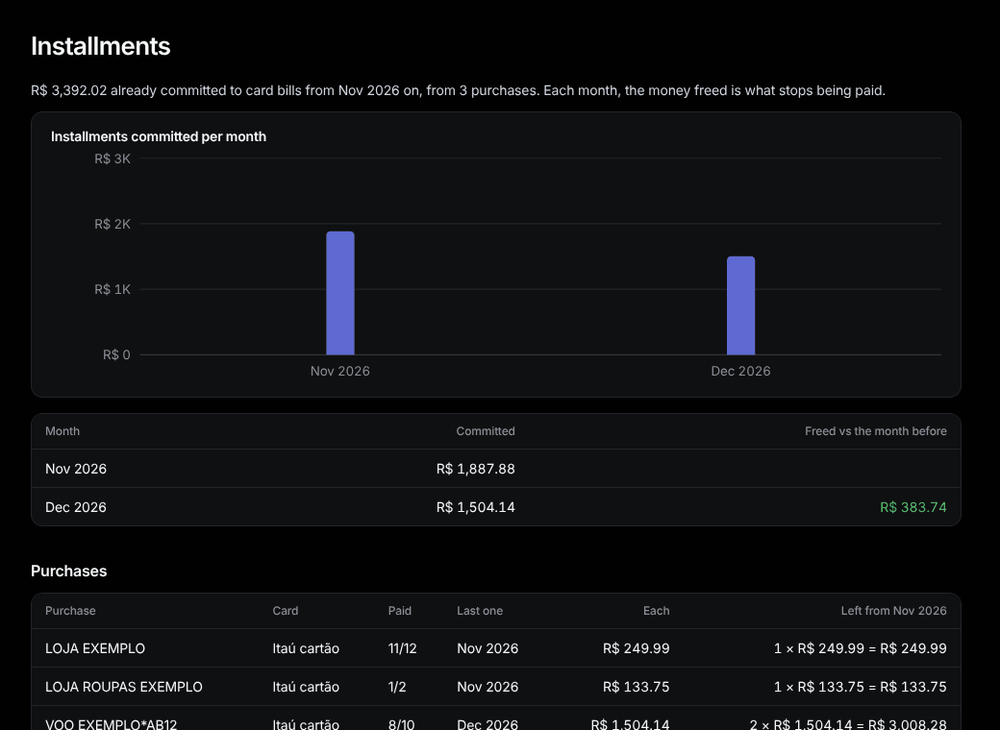

# Installments

Sidebar: **Overview › Installments**.

What is already committed to future card bills, by month, and the purchases behind it.

- **Committed:** the installments due on each future bill.
- **Freed vs the month before:** money that stops being paid as purchases end.
- **Left from …:** what is still to pay for each purchase, and **Last one**.
- **What the banks say:** Itaú prints its committed total on the bill, a check on the projection.

To change a purchase (canceled, reimbursed), open one of its installments: see [A transaction](transaction.md#installments).
