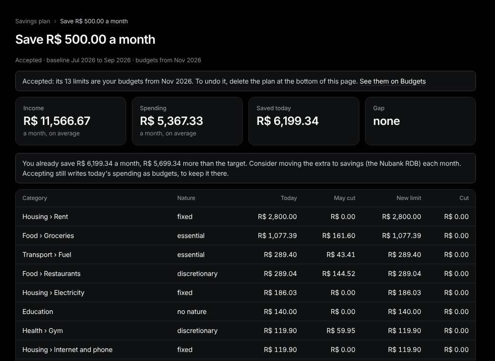

# Savings plan

Sidebar: **Planning › Savings plan**.

1. Type how much to save a month, pick the starting month and press **Make a plan**.
2. Tally proposes a limit per category from your last three complete months. It is a draft: nothing changes yet.
3. Edit any **New limit**, then press **Accept and write budgets from …**. The limits become your [budgets](budgets.md).

**How far it cuts.** By each category's nature: fixed 0%, essential up to 15%, discretionary up to 50% (change it on [Categories](categories-and-rules.md)). If that isn't enough, **Other levers** lists installments ending soon and fixed costs to renegotiate.

**Undo.** At the bottom of the plan, press **Delete plan**. Tick **Also remove the budgets it wrote** to go back to the limits you had before. Transactions are never touched.
