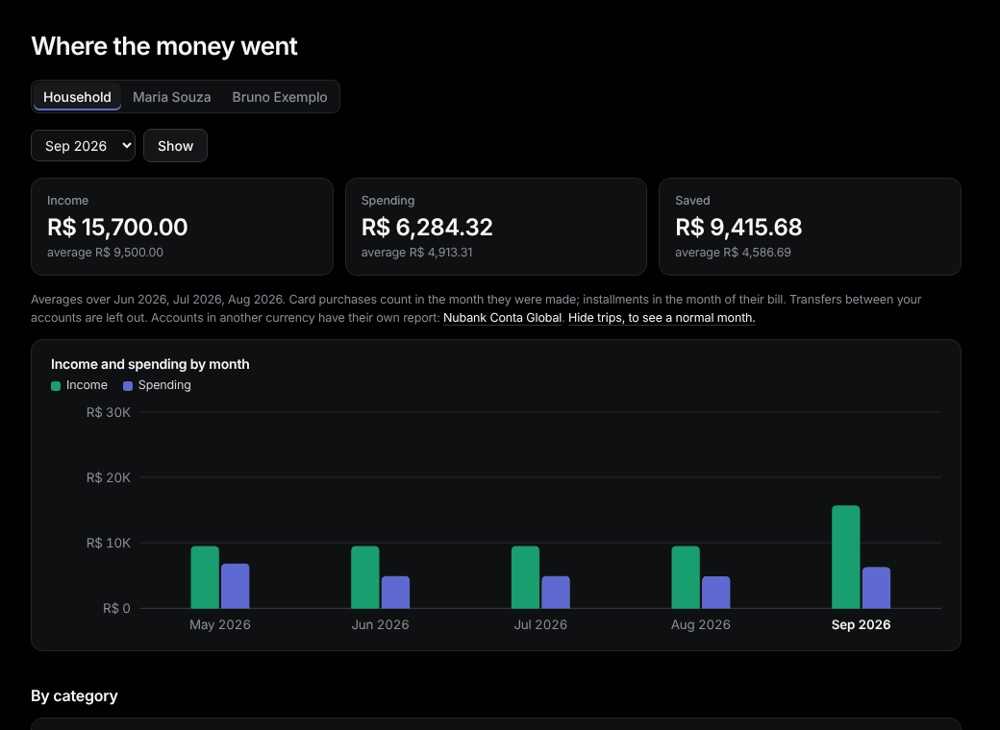

# Report

Sidebar: **Overview › Report**.

1. Pick a month and press **Show**.
2. Read the totals, then **By category** (with share, three-month average and change), **By nature**, **Top payees** and **Card installments this month**.
3. Click a category, payee or number to see the matching rows in [Transactions](transactions.md).

**Rules.** Card purchases count in the month they were made; installments in the month of their bill. Transfers between your accounts are left out. Adjusted rows count their adjusted amount.

**Trips.** Press **Hide trips, to see a normal month.**; **Show them.** brings them back.

Accounts in another currency (Conta Global) have [their own report](accounts.md#account-report).
