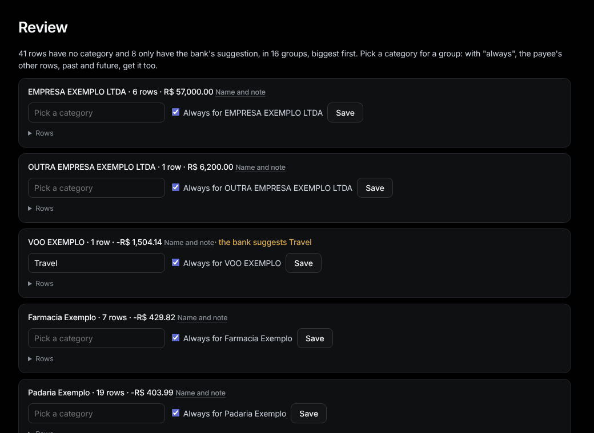

# Review

Sidebar: **Organize › Review**.

Rows without a category, grouped by payee, biggest first. Gold text is the bank's suggestion.

1. Pick a category for a group.
2. Leave **Always for …** ticked so the payee's other rows, past and future, get it too.
3. Press **Save**.

When nothing is left: "Nothing to review: every row has a category."
