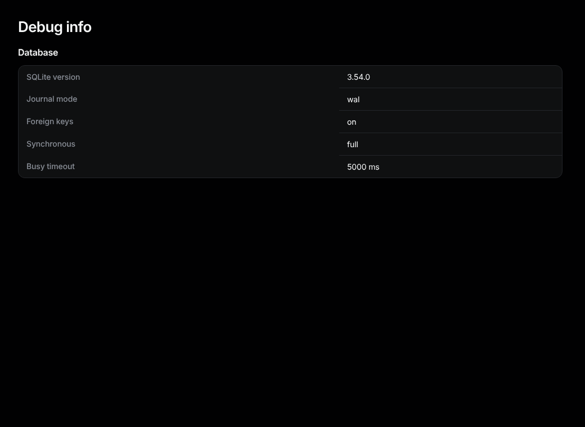
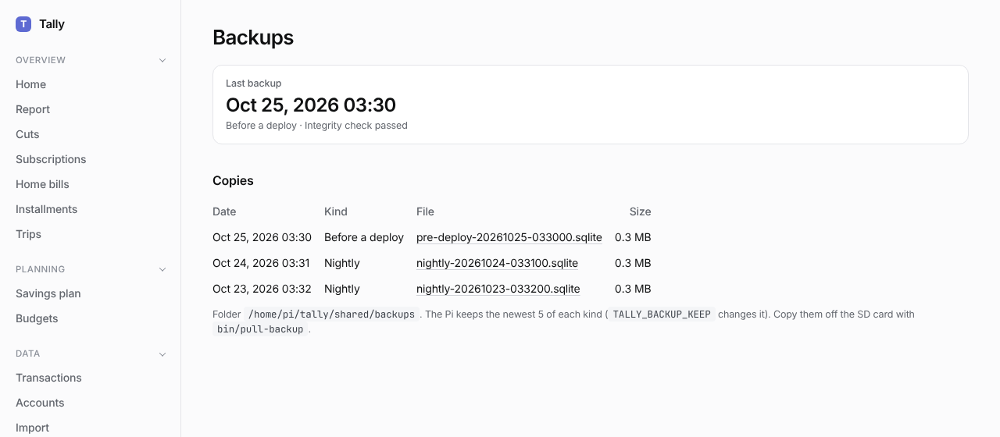

# Settings, login, debug info, backups and the privacy guard

## Settings

Settings live in `.env`; put your own values in `.env.local` (not committed). The full list is in the [README](../../../README.md#configuration). The ones you are most likely to change:

- `DEFAULT_LOCALE`: `pt-BR` or `en`.
- `TIME_ZONE`: for example `America/Sao_Paulo`.
- `DATABASE_URL`: where the database is.

## Login (basic auth)

Set both `BASIC_AUTH_USERNAME` and `BASIC_AUTH_PASSWORD` in `.env.local` and restart: the browser asks for them. Leave both empty for no login. With only one set, Tally answers 503 until you fix it.

## Debug info

Sidebar, bottom: **Debug info**. Shows the SQLite version and settings (journal mode, foreign keys, synchronous, busy timeout). Look at it on a new machine or after a database problem.

**Download the database** saves a copy of everything (not receipts or imported files) as one `.sqlite` file. It only shows when the login is on, or when `ALLOW_EXPORT_WITHOUT_LOGIN=true`.

## Backups

Sidebar, Data: **Backups**. On the Pi, a copy of the database is made every night at 03:30 and before each deploy, and checked. The page shows the last one, whether its check passed, and the copies kept (the newest 5 of each kind). If the last backup failed, or there is none from the last 36 hours, the page and the home page show a red warning.

Click a file to download it; like the database download, only with the login on or `ALLOW_EXPORT_WITHOUT_LOGIN=true`. To copy them all to your computer, run `bin/pull-backup`.

## Privacy guard

The repository is public. Put strings that must never be committed (your CPF, account numbers, names) in `data/private-patterns.txt`, one per line (`/regex/` works too). This file is not committed.

- `bin/setup` installs `bin/check-private` as a pre-commit hook: a commit containing one of them is refused.
- `bin/check-private --all` scans every tracked file.
