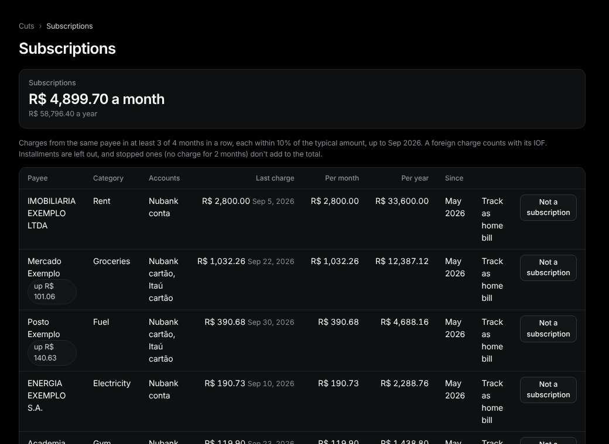

# Subscriptions

Sidebar: **Overview › Subscriptions**.

Charges that repeat every month, with their cost per month and per year.

**How one is found.** The same payee in at least 3 of 4 months in a row, each within 10% of the typical amount. Installments are left out. A foreign charge counts with its IOF.

- **up R$ X:** the last charge is higher than the one before (any rise when the two before were equal, otherwise more than 10%).
- **stopped:** no charge for 2 months. It doesn't add to the total.

**Actions.**
- **Not a subscription** hides it; **Undo** brings it back.
- **Track as home bill** creates a [home bill](home-bills.md) for it.
- To add one Tally missed, tick **It's a subscription** on the [counterparty](counterparties.md) page.
