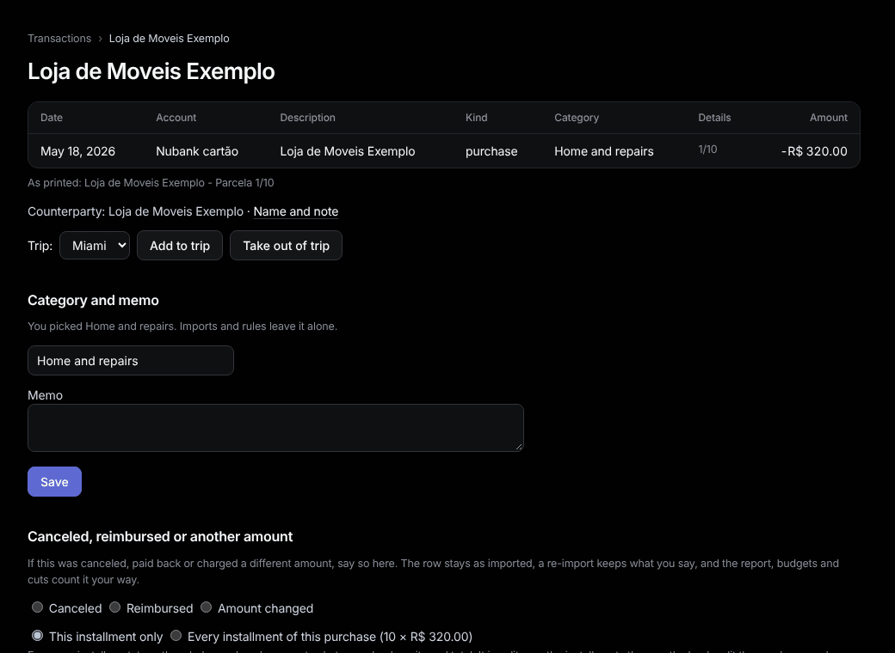

# A transaction

Open it from [Transactions](transactions.md) by clicking its description.

**Category and memo.** Pick a category, write a memo, press **Save**. A category you pick is never changed by imports or rules.

**Trip.** Pick a trip and press **Add to trip** (for a flight bought weeks before), or **Take out of trip**.

## Canceled, reimbursed or another amount

1. Pick **Canceled**, **Reimbursed** (type what came back) or **Amount changed** (type the real amount).
2. If the money came back in an imported row, pick it under **Paid back by an imported row**: it then counts inside this purchase, not on its own.
3. Press **Save**.

The row stays as imported; the report, budgets and cuts count it your way. A re-import keeps it. **Remove the adjustment** undoes it.

**Installments.** On an installment, pick **Every installment of this purchase** and type the whole purchase's amount. Tally splits it the way the bank did, and adjusts later installments as they are imported.
