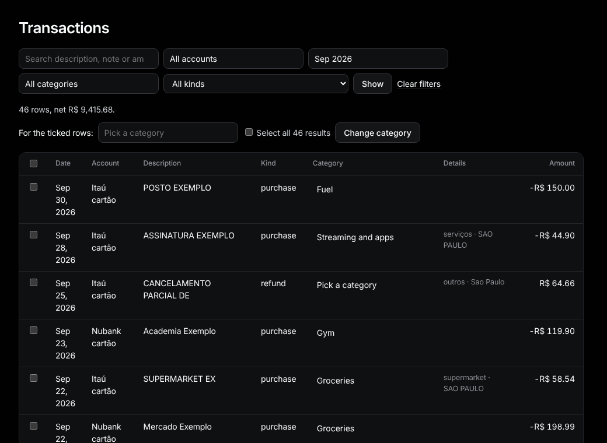

# Transactions

Sidebar: **Data › Transactions**.

**Filter.** Pick an account, month, category or kind and press **Show**. **Clear filters** resets them. Links from the report and other pages open this list already filtered.

**Totals.** The cards cover every result, not just this page. **Money out** and **Money in** leave transfers out (a card bill paid from your account, money between your accounts or between people at home): those count once on each side, so they get their own **Transfers** card. The **Balance** is the three added up.

**Search.** Type in **Search description, note or amount**. Text ignores accents and case. A number like `45.90` finds that exact amount, spent or received.

**One row.** Click the category in the row and pick another. It saves at once.

**Many rows.**
1. Tick the rows (or the box in the header for the whole page).
2. To include every result, not just this page, tick **Select all N results**.
3. Pick a category next to **For the ticked rows:** and press **Change category**.

Transfers have no category and are left as they were. Click a description to open [the transaction](transaction.md).
