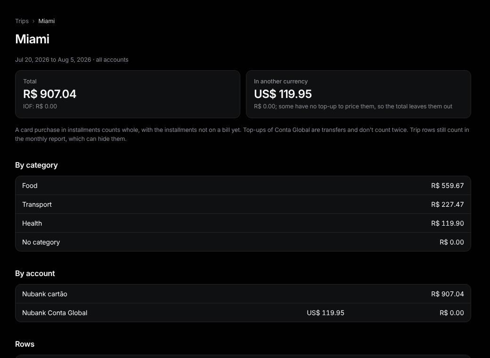

# Trips

Sidebar: **Overview › Trips**.

1. Under **New trip**, type a name, the **First day** and **Last day**. Cards and foreign-currency accounts come ticked; change them, or tick **All accounts**.
2. Press **Add**. Every row between those dates is in the trip.
3. Open the trip. **Take out** a row that isn't part of it; **Put back** undoes it.
4. **Edit trip** at the bottom changes the name, dates or accounts; rows you added or took out stay that way.
5. For a row from another date (a flight bought weeks before), open it and press **Add to trip**. Or look under **Suggestions** on the trip: rows from the 60 days before it in another currency, from a merchant already on the trip, in Travel, or with a word from **Travel words** (edit the list at the bottom of Trips). **Add** brings one in; **Take out** hides it.

**Totals.** One total across accounts, then **By account**. A card purchase in installments counts whole. Conta Global rows are shown **In another currency**, with the reais estimate at what the top-ups cost; top-ups don't count twice.

**Map.** A dot for each city where an Itaú card or Conta Global purchase was made (Nubank doesn't say where). Hover a dot for its name; places it can't find are listed under the map.

Trip rows still count in the monthly [report](report.md), which can hide them.
