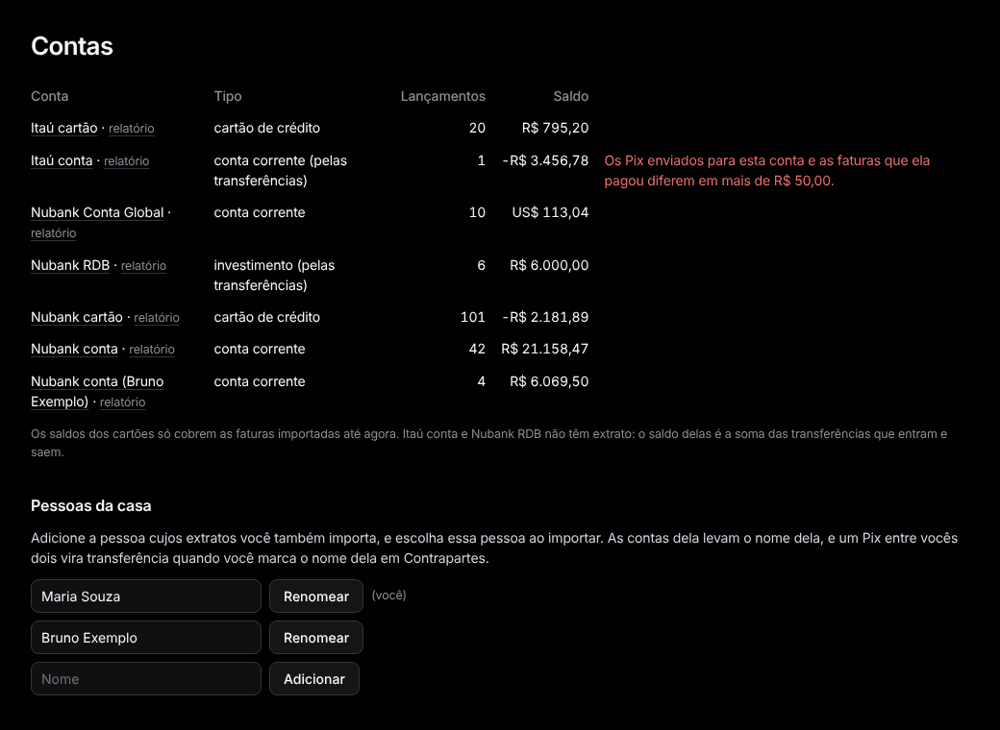
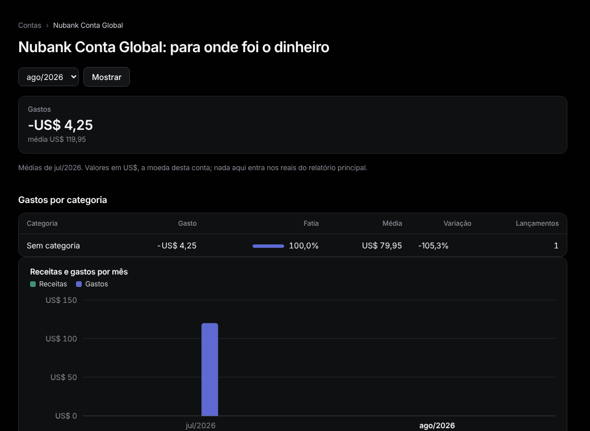

# Contas

Menu: **Dados › Contas**.

Cada conta com seu saldo e um link de **relatório**. O saldo dos cartões só cobre as faturas importadas até agora.

## Pessoas da casa

1. Digite um nome e aperte **Adicionar**. Aperte **Renomear** para corrigir.
2. Importe os arquivos da pessoa escolhendo o nome dela em **De quem são os extratos:**. As contas dela levam o nome dela.
3. Em [Contrapartes](counterparties.md), marque o nome dela como dela, para que um Pix entre vocês seja uma transferência.

Com duas pessoas, Início, Relatório e Orçamentos ganham o seletor **Casa / pessoa**. Os orçamentos são da casa toda.

## Conferência das faturas

Para cada fatura do cartão: **paga integralmente**, **em aberto** (parte paga), **diferença de** um valor, ou **pagamento ainda não importado**.

## Relatório da conta

O link **relatório** mostra os gastos de uma conta por categoria e mês. A Conta Global fica em US$, nunca somada aos reais do relatório principal, com quanto custou cada dólar das recargas.

