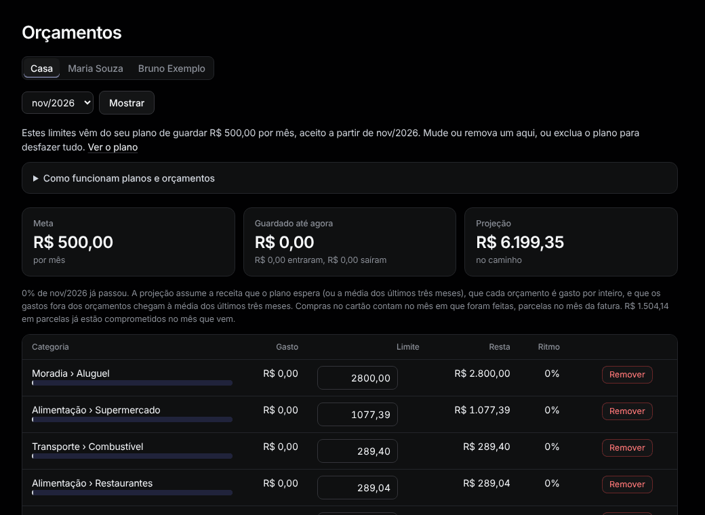

# Orçamentos

Menu: **Planejamento › Orçamentos**.

Um orçamento é um limite mensal para uma categoria. Aceitar um [plano de economia](plan.md) cria os orçamentos, ou crie um à mão em **Adicionar um orçamento**, no fim (categoria, limite, **Salvar**).

**Como ler.** Por categoria: **Gasto**, **Limite**, **Resta** e **Ritmo** (o gasto contra o que o limite permite até hoje; acima de 110% aparece **estourou**). Os cartões no topo mostram a meta, o guardado até agora e a projeção do mês. Quando o mês acaba, **Resultado de cada mês** diz se a meta foi alcançada.

**Mudar.**
- Edite um limite e aperte Enter: vale daquele mês em diante.
- **Remover** encerra um orçamento daquele mês em diante; os meses anteriores ficam com ele.
- **Remover todos os orçamentos a partir de …** limpa todos daquele mês em diante.
