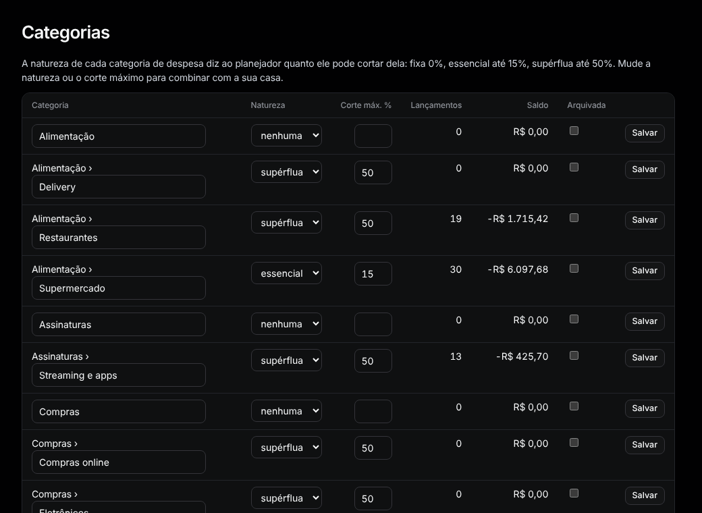
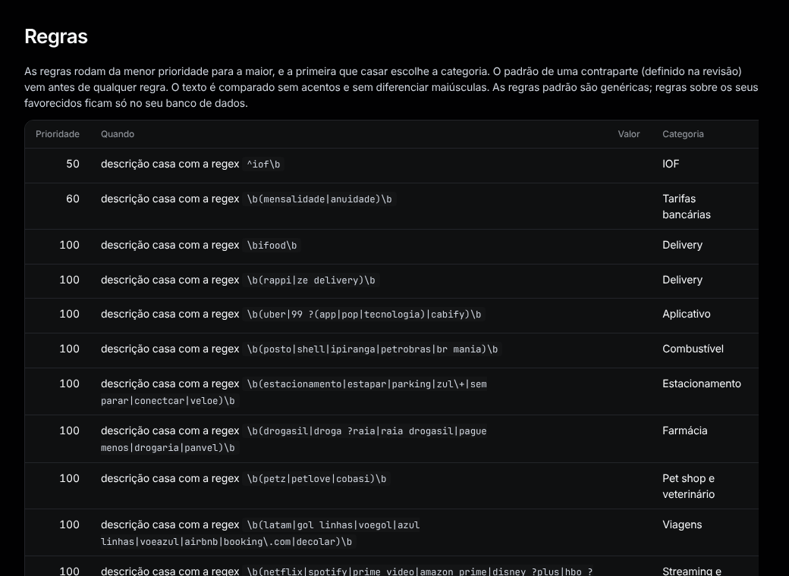

# Categorias e regras

## Categorias

Menu: **Organizar › Categorias**.

- **Adicionar:** preencha o formulário no fim (nome, primeiro nível ou dentro de outra, tipo, natureza) e aperte **Adicionar**.
- **Renomear / mudar natureza ou Corte máx. %:** edite a linha e aperte **Salvar**.
- **Arquivar:** marque **Arquivada** e aperte **Salvar**. Desmarque para trazer de volta.

A natureza diz ao [plano de economia](plan.md) quanto ele pode cortar: fixa 0%, essencial até 15%, supérflua até 50%.

## Regras

Menu: **Organizar › Regras**.

Uma regra escolhe a categoria quando um lançamento combina, por exemplo *descrição contém "uber"* → Aplicativo.

- **Adicionar:** escolha o que comparar, como (contém, é, começa com, casa com a regex), o texto, se quiser uma faixa de valor e de quem são os extratos, depois a categoria, e aperte **Adicionar**.
- **Desligar uma:** aperte **Remover**. Regras iniciais (**Origem: padrão**) vêm com o Tally; as removidas não voltam.
- **Prioridade** menor roda primeiro; a primeira que combina vence. O "sempre" de um favorecido em Revisar vem antes de qualquer regra.
- Lançamentos com categoria escolhida à mão nunca mudam; os outros são categorizados de novo quando as regras mudam.
