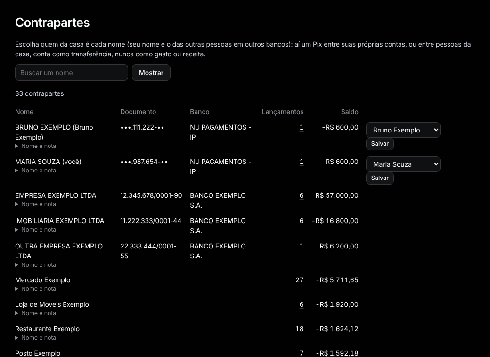

# Contrapartes

Menu: **Organizar › Contrapartes**.

Todo mundo de quem veio ou para quem foi dinheiro. Lojas do cartão são agrupadas pelo nome fixo, então "LATAM AIR*ABC" e "LATAM AIR*XYZ" viram uma só.

**Sou eu.** Ache seu próprio nome como outros bancos o mostram e aperte **Sou eu**. Um Pix entre suas contas passa a contar como transferência, não como gasto ou receita. Com duas pessoas na casa, escolha de quem é cada nome e aperte **Salvar**.

**Nome e nota.** Clique em **Nome e nota** para dar ao favorecido um nome seu e uma nota. Importações e regras continuam usando o nome do banco. Na página da contraparte, **É uma assinatura** a coloca em [Assinaturas](subscriptions.md) mesmo quando ela não é encontrada lá, e **Ver os lançamentos** abre as linhas dela.

**Buscar um nome** filtra a lista.
