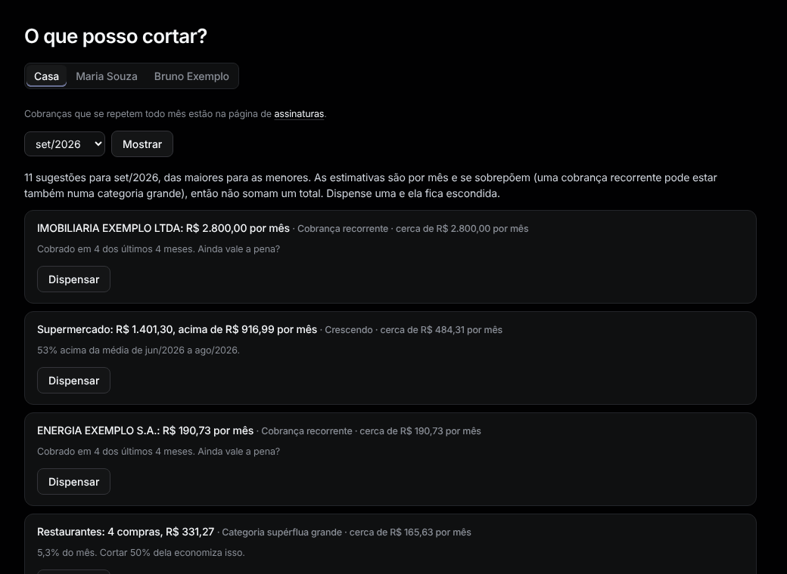

# Cortes

Menu: **Visão geral › Cortes** ("O que posso cortar?").

Sugestões para o último mês, das maiores para as menores, cada uma com quanto economiza por mês, mais ou menos:

- **Categoria supérflua grande**, **Crescendo** (acima da média), **Muitas compras pequenas**
- **Cobrança recorrente**, **Novas parcelas**, **Tarifas e juros**, **Possível cobrança em dobro**

As estimativas se sobrepõem, então não somam um total. Aperte **Dispensar** para esconder uma; ela continua escondida. Ache em **Dispensadas** e aperte **Mostrar de novo** para trazer de volta.
