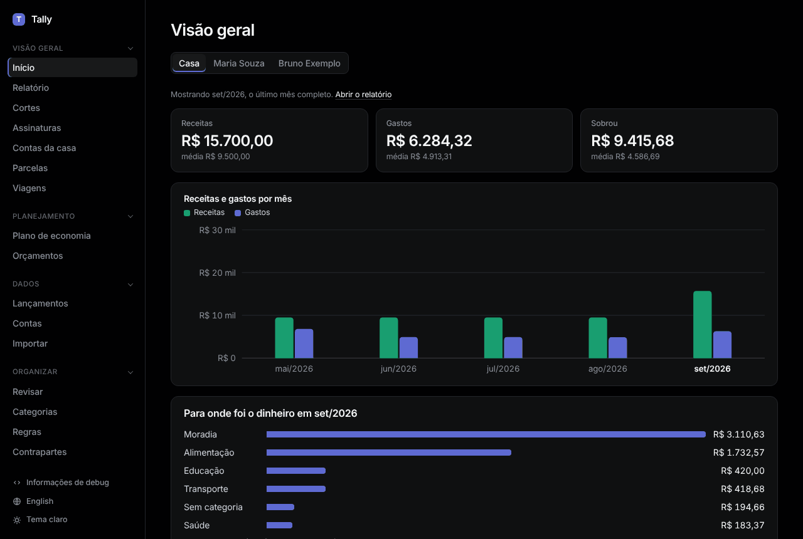

# Primeiro uso

```sh
bin/setup   # gems, bancos de dados, hook de privacidade
bin/dev     # http://localhost:2300
```

Depois, [importe seus extratos](import.md).



**Menu lateral.** Quatro seções: Visão geral, Planejamento, Dados, Organizar. Clique no título de uma seção para recolhê-la; o Tally lembra quais estão recolhidas.

**Idioma.** No fim do menu, aperte **English** ou **Português**. Os nomes de categoria que o Tally criou seguem o idioma; os que você digitou ficam como estão.

**Tema.** Aperte **Tema claro** ou **Tema escuro**. Depois de escolher um, **Tema do sistema** volta a seguir o computador.

## Todo mês

1. **Importar** os extratos e faturas do mês que passou.
2. **Revisar**: dar categoria aos lançamentos novos.
3. **Relatório**: ver para onde foi o dinheiro.
4. **Orçamentos**: conferir se está no ritmo.
