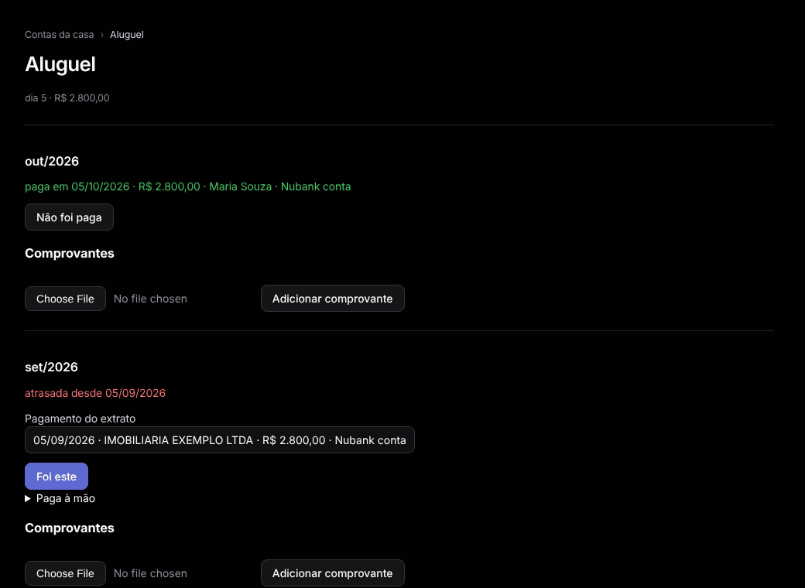

# Contas da casa

Menu: **Visão geral › Contas da casa**.

Aluguel, energia, água, internet: o que vence todo mês e quem pagou.

1. Em **Nova conta da casa**, digite um nome, o **Vencimento** (dia), se quiser o valor previsto e a categoria, e aperte **Adicionar**. Ou aperte **Acompanhar como conta da casa** em [Assinaturas](subscriptions.md).
2. Abra a conta. Para cada mês:
   - escolha o lançamento em **Pagamento do extrato** e aperte **Foi este**, ou
   - abra **Paga à mão**, preencha o dia, o valor e **Quem pagou**, e aperte **Marcar como paga**.
3. Em **Comprovantes**, escolha um JPEG, PNG ou PDF (até 10 MB) e aperte **Adicionar comprovante**.

Cada mês mostra **paga em**, **vence em** ou, em vermelho, **atrasada desde**. **Não foi paga** desfaz um pagamento. Quem pagou um pagamento ligado é o dono da conta. Contas, pagamentos e comprovantes sobrevivem ao `bin/reset-db`.
