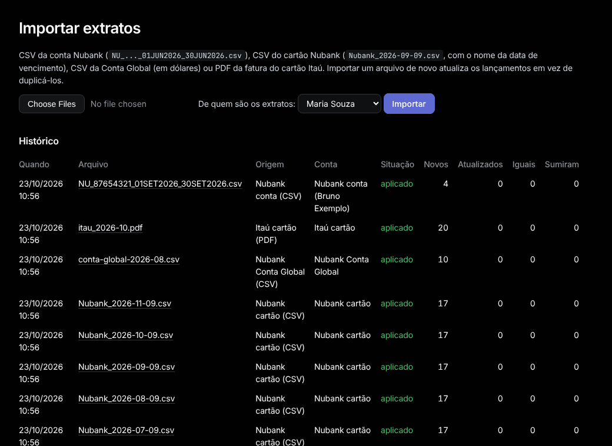

# Importar

Menu: **Dados › Importar**.

1. Em **De quem são os extratos:**, escolha a pessoa (só aparece com mais de uma pessoa).
2. Escolha um ou mais arquivos e aperte **Importar**.
3. A página do resultado mostra quantos lançamentos são **Novos**, **Atualizados**, **Sem mudança** e **Faltando**, e os avisos.

| Arquivo | Nome |
|---|---|
| CSV da conta Nubank | como vem: `NU_..._01JUN2026_30JUN2026.csv` |
| CSV do cartão Nubank | o vencimento da fatura: `Nubank_2026-09-09.csv` |
| PDF da fatura Itaú | qualquer um |
| CSV da Conta Global (US$) | qualquer um |
| CSV do cartão XP | o vencimento da fatura: `Fatura2026-10-15.csv` (como vem) |

Pela linha de comando: `bundle exec rake "tally:import[data/statements/*]"`, ou `"tally:import[arquivos,Nome]"` para os arquivos de outra pessoa.

## Importar de novo

- Um arquivo com lançamentos novos **atualiza** os antigos, nunca duplica. Suas categorias, notas e ajustes ficam.
- O mesmo arquivo de novo não muda nada ("Este arquivo exato já foi importado").
- Lançamentos que sumiram de um arquivo mais novo ficam, listados em **Não estão mais no arquivo**.
- **Extratos faltando** (em Importar e Contas) mostra os meses entre seus arquivos que nunca foram importados.

## Recomeçar: `bin/reset-db`

Use quando uma correção de importação precisa ler todos os arquivos de novo. Pare o `bin/dev`, rode, digite `yes`. Ele faz uma cópia de segurança antes.

- **Fica:** contas da casa, seus pagamentos e comprovantes.
- **Refazer depois de reimportar:** "Sou eu" e os nomes da casa em [Contrapartes](counterparties.md), as escolhas "sempre" em [Revisar](review.md), suas regras e mudanças de categoria, ajustes, viagens, o plano e os orçamentos.
