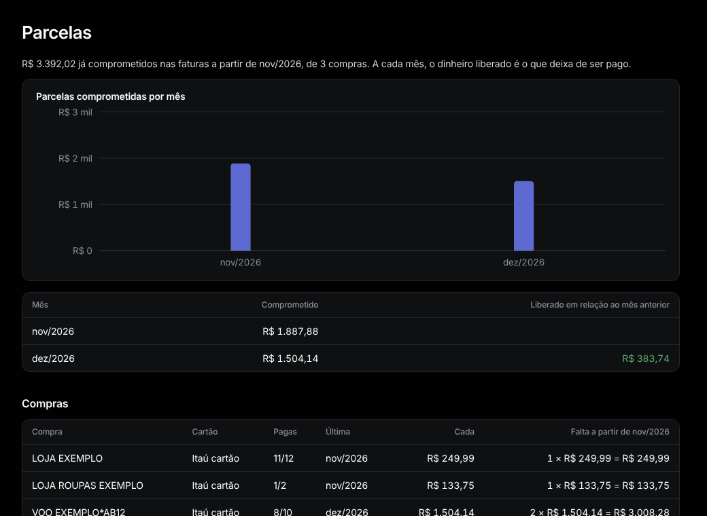

# Parcelas

Menu: **Visão geral › Parcelas**.

O que já está comprometido nas próximas faturas do cartão, por mês, e as compras por trás.

- **Comprometido:** as parcelas de cada fatura futura.
- **Liberado em relação ao mês anterior:** o dinheiro que para de ser pago quando as compras terminam.
- **Falta a partir de …:** o que ainda falta pagar de cada compra, e a **Última**.
- **O que os bancos dizem:** o Itaú imprime o total comprometido na fatura, uma conferência da projeção.

Para mudar uma compra (cancelada, reembolsada), abra uma das parcelas: veja [Um lançamento](transaction.md#cancelado-reembolsado-ou-outro-valor).
