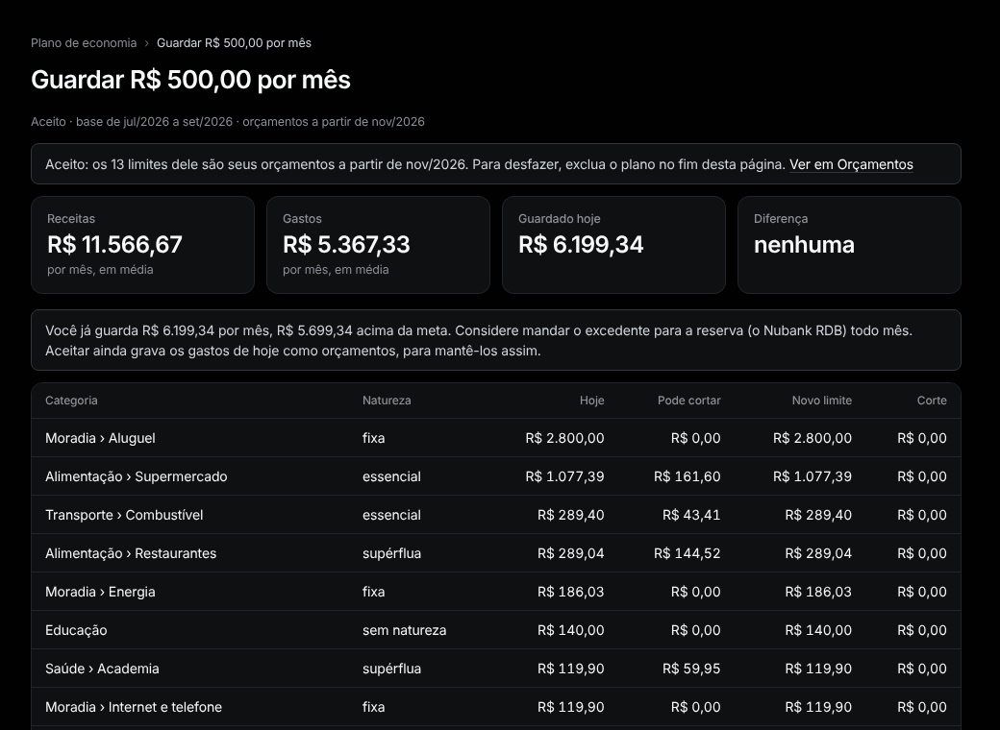

# Plano de economia

Menu: **Planejamento › Plano de economia**.

1. Digite quanto guardar por mês, escolha o mês de início e aperte **Fazer um plano**.
2. O Tally propõe um limite por categoria a partir dos seus últimos três meses completos. É um rascunho: nada muda ainda.
3. Edite qualquer **Novo limite** e aperte **Aceitar e criar orçamentos a partir de …**. Os limites viram seus [orçamentos](budgets.md).

**Quanto ele corta.** Pela natureza de cada categoria: fixa 0%, essencial até 15%, supérflua até 50% (mude em [Categorias](categories-and-rules.md)). Se não basta, **Outras alavancas** lista parcelas que terminam logo e custos fixos para renegociar.

**Desfazer.** No fim do plano, aperte **Excluir plano**. Marque **Remover também os orçamentos que ele criou** para voltar aos limites de antes. Os lançamentos nunca mudam.
