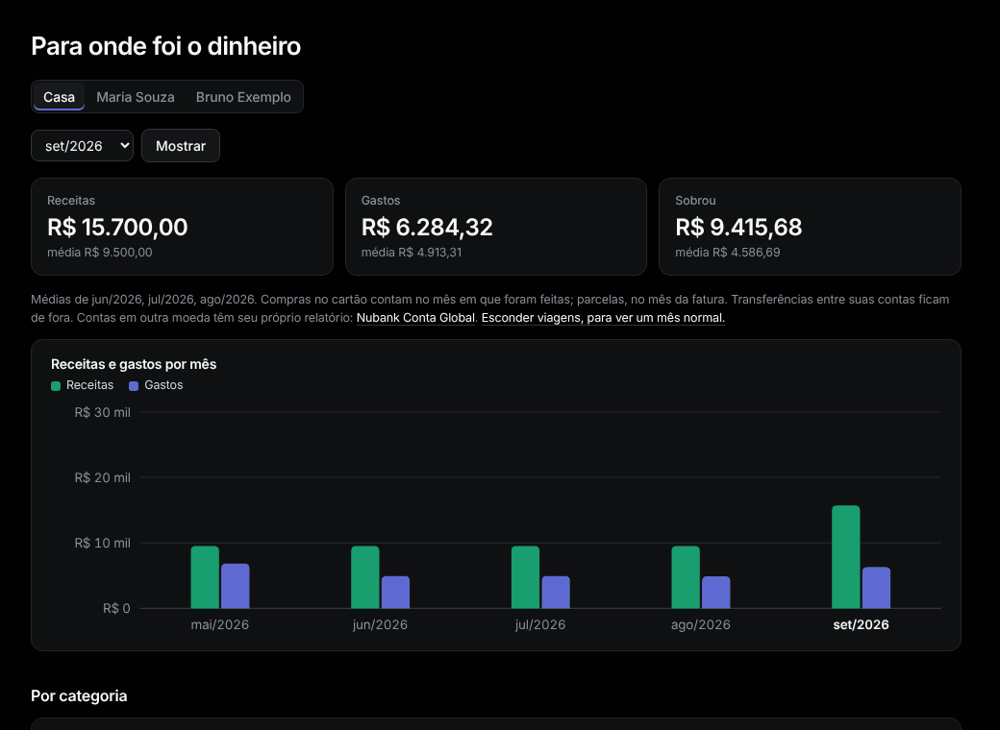

# Relatório

Menu: **Visão geral › Relatório**.

1. Escolha um mês e aperte **Mostrar**.
2. Veja os totais, depois **Por categoria** (com fatia, média de três meses e variação), **Por natureza**, **Maiores favorecidos** e **Parcelas do cartão neste mês**.
3. Clique numa categoria, favorecido ou número para ver os lançamentos em [Lançamentos](transactions.md).

**Regras.** Compras no cartão contam no mês em que foram feitas; parcelas, no mês da fatura. Transferências entre suas contas ficam de fora. Lançamentos ajustados contam o valor ajustado.

**Viagens.** Aperte **Esconder viagens, para ver um mês normal.**; **Mostrar.** traz de volta.

Contas em outra moeda (Conta Global) têm [relatório próprio](accounts.md#relatório-da-conta).
