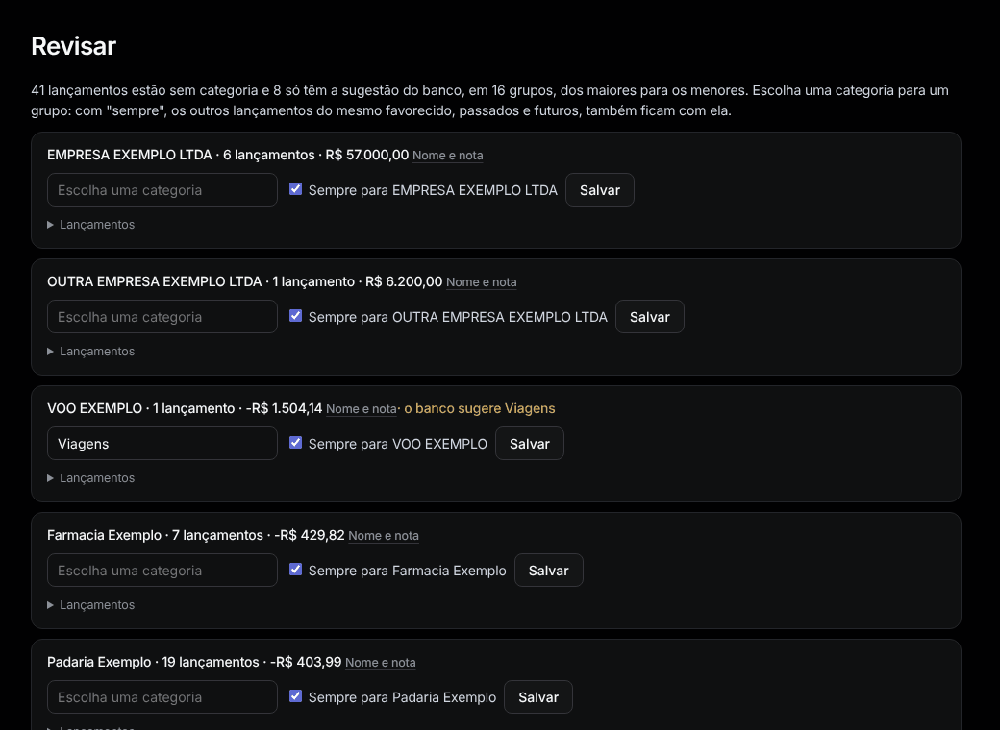

# Revisar

Menu: **Organizar › Revisar**.

Lançamentos sem categoria, agrupados por favorecido, dos maiores para os menores. O texto dourado é a sugestão do banco.

1. Escolha uma categoria para um grupo.
2. Deixe **Sempre para …** marcado para que os outros lançamentos do favorecido, passados e futuros, fiquem com ela também.
3. Aperte **Salvar**.

Quando não sobra nada: "Nada para revisar: todo lançamento tem categoria."
