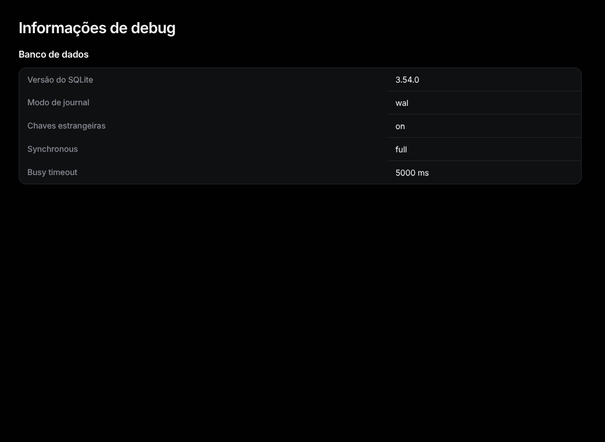
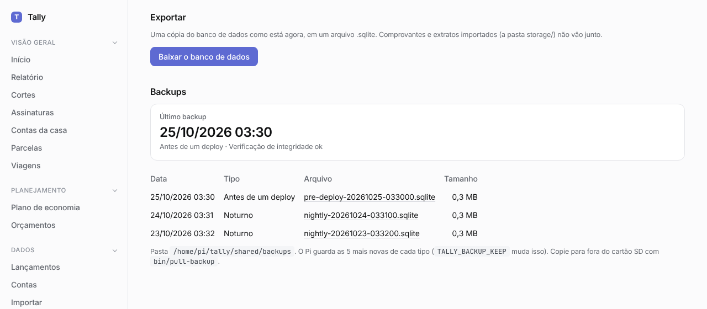

# Configurações, login, informações de debug, backups e a proteção de privacidade

## Configurações

As configurações ficam no `.env`; coloque seus valores no `.env.local` (não vai para o repositório). A lista completa está no [README](../../../README.md#configuration). As que você mais deve mudar:

- `DEFAULT_LOCALE`: `pt-BR` ou `en`.
- `TIME_ZONE`: por exemplo `America/Sao_Paulo`.
- `DATABASE_URL`: onde fica o banco de dados.

## Login (basic auth)

Defina `BASIC_AUTH_USERNAME` e `BASIC_AUTH_PASSWORD` no `.env.local` e reinicie: o navegador pede os dois. Deixe os dois vazios para não ter login. Com só um definido, o Tally responde 503 até você corrigir.

## Informações de debug

Fim do menu: **Informações de debug**. Mostra a versão e as configurações do SQLite (journal mode, foreign keys, synchronous, busy timeout). Olhe numa máquina nova ou depois de um problema no banco.

**Baixar o banco de dados** salva uma cópia de tudo (sem comprovantes nem extratos importados) em um arquivo `.sqlite`. Só aparece com o login ligado, ou com `ALLOW_EXPORT_WITHOUT_LOGIN=true`.

## Backups

Informações de debug, abaixo da exportação: **Backups**. No Pi, uma cópia do banco é feita toda noite às 03:30 e antes de cada deploy, e verificada. A seção mostra a última, se a verificação passou, e as cópias guardadas (as 5 mais novas de cada tipo). Se o último backup falhou, ou não há nenhum das últimas 36 horas, a seção e o início mostram um aviso em vermelho.

Clique num arquivo para baixá-lo; como no download do banco, só com o login ligado ou `ALLOW_EXPORT_WITHOUT_LOGIN=true`. Para copiar todos para o seu computador, rode `bin/pull-backup`.

## Proteção de privacidade

O repositório é público. Coloque o que nunca pode ir para ele (seu CPF, números de conta, nomes) em `data/private-patterns.txt`, um por linha (`/regex/` também vale). Esse arquivo não vai para o repositório.

- O `bin/setup` instala o `bin/check-private` como hook de pre-commit: um commit com um desses textos é recusado.
- `bin/check-private --all` verifica todos os arquivos do repositório.
