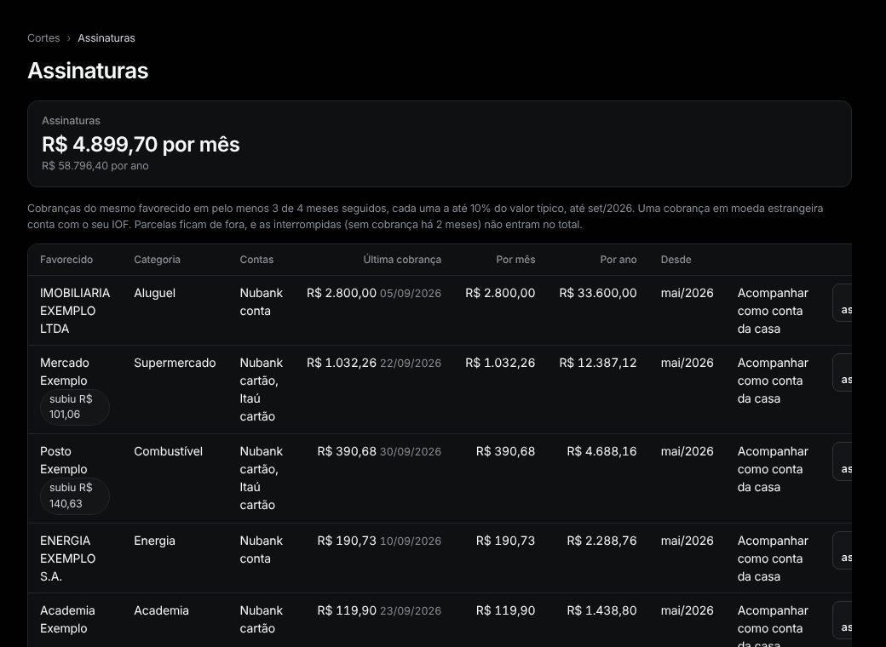

# Assinaturas

Menu: **Visão geral › Assinaturas**.

Cobranças que se repetem todo mês, com o custo por mês e por ano.

**Como uma é encontrada.** O mesmo favorecido em pelo menos 3 de 4 meses seguidos, cada vez a até 10% do valor típico. Parcelas ficam de fora. Uma cobrança no exterior conta com o IOF.

- **subiu R$ X:** a última cobrança é maior que a anterior (qualquer alta quando as duas antes eram iguais; senão, mais de 10%).
- **interrompida:** sem cobrança há 2 meses. Não entra no total.

**Ações.**
- **Não é assinatura** esconde; **Desfazer** traz de volta.
- **Acompanhar como conta da casa** cria uma [conta da casa](home-bills.md) para ela.
- Para incluir uma que o Tally não achou, marque **É uma assinatura** na página da [contraparte](counterparties.md).
