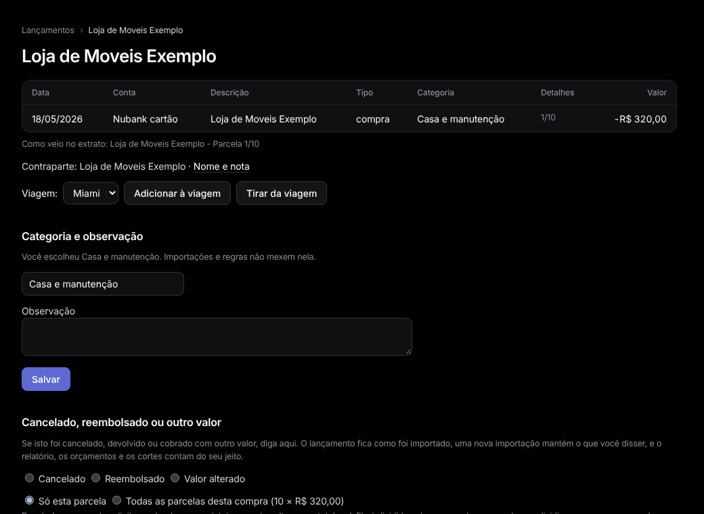

# Um lançamento

Abra pela lista de [Lançamentos](transactions.md), clicando na descrição.

**Categoria e memo.** Escolha uma categoria, escreva um memo, aperte **Salvar**. Uma categoria escolhida por você nunca é mudada por importações ou regras.

**Viagem.** Escolha uma viagem e aperte **Adicionar à viagem** (para uma passagem comprada semanas antes), ou **Tirar da viagem**.

## Cancelado, reembolsado ou outro valor

1. Escolha **Cancelado**, **Reembolsado** (digite o que voltou) ou **Valor alterado** (digite o valor real).
2. Se o dinheiro voltou num lançamento importado, escolha-o em **Devolvido por um lançamento importado**: ele passa a contar dentro desta compra, não sozinho.
3. Aperte **Salvar**.

O lançamento fica como foi importado; relatório, orçamentos e cortes contam do seu jeito. Uma reimportação mantém o ajuste. **Tirar o ajuste** desfaz.

**Parcelas.** Numa parcela, escolha **Todas as parcelas desta compra** e digite o valor da compra inteira. O Tally divide como o banco dividiu e ajusta as próximas parcelas quando forem importadas.
