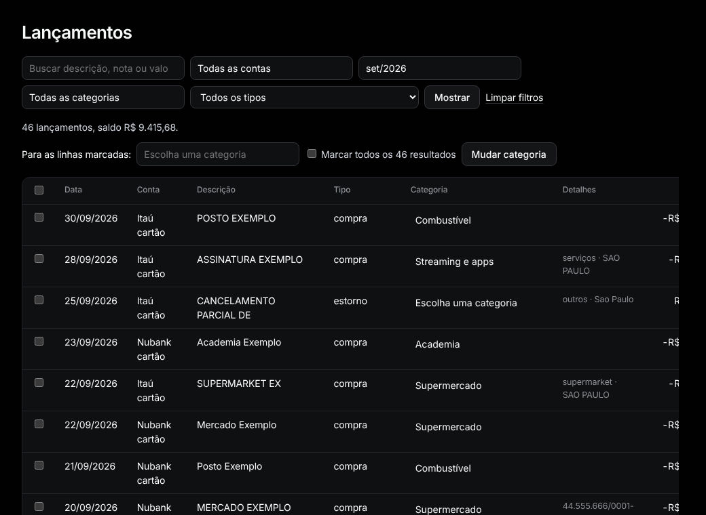

# Lançamentos

Menu: **Dados › Lançamentos**.

**Filtrar.** Escolha conta, mês, categoria ou tipo e aperte **Mostrar**. **Limpar filtros** volta tudo. Links do relatório e de outras páginas abrem esta lista já filtrada.

**Totais.** Os cartões somam todos os resultados, não só esta página. **Saídas** e **Entradas** deixam as transferências de fora (fatura paga pela conta, dinheiro entre suas contas ou entre as pessoas da casa): elas contam uma vez de cada lado, por isso têm o cartão **Transferências**. O **Saldo** é a soma dos três.

**Buscar.** Digite em **Buscar descrição, nota ou valor**. O texto ignora acentos e maiúsculas. Um número como `45,90` acha esse valor exato, gasto ou recebido.

**Um lançamento.** Clique na categoria da linha e escolha outra. Salva na hora.

**Vários lançamentos.**
1. Marque as linhas (ou a caixa do cabeçalho para a página toda).
2. Para incluir todos os resultados, não só esta página, marque **Marcar todos os N resultados**.
3. Escolha uma categoria ao lado de **Para as linhas marcadas:** e aperte **Mudar categoria**.

Transferências não têm categoria e ficam como estavam. Clique na descrição para abrir [o lançamento](transaction.md).
