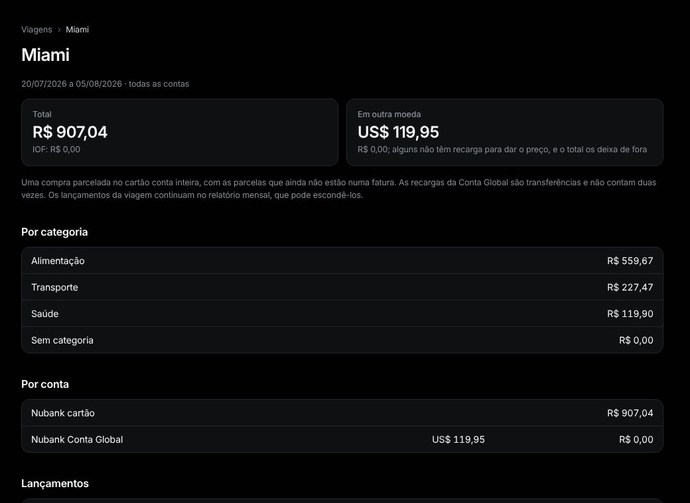

# Viagens

Menu: **Visão geral › Viagens**.

1. Em **Nova viagem**, digite um nome, o **Primeiro dia** e o **Último dia**. Cartões e contas em outra moeda já vêm marcados; mude, ou marque **Todas as contas**.
2. Aperte **Adicionar**. Todo lançamento entre essas datas entra na viagem.
3. Abra a viagem. Aperte **Tirar** num lançamento que não faz parte; **Devolver** desfaz.
4. **Editar viagem**, no fim da página, muda o nome, as datas ou as contas; o que você adicionou ou tirou continua assim.
5. Para um lançamento de outra data (uma passagem comprada semanas antes), abra-o e aperte **Adicionar à viagem**.

**Totais.** Um total somando as contas, depois **Por conta**. Uma compra parcelada conta inteira. Os lançamentos da Conta Global aparecem **Em outra moeda**, com a estimativa em reais pelo custo das recargas; as recargas não contam duas vezes.

**Mapa.** Um ponto para cada cidade onde houve compra no cartão Itaú ou na Conta Global (o Nubank não diz onde). Passe o mouse num ponto para ver o nome; os lugares que ele não acha aparecem embaixo do mapa.

Os lançamentos da viagem continuam no [relatório](report.md) do mês, que pode escondê-los.
